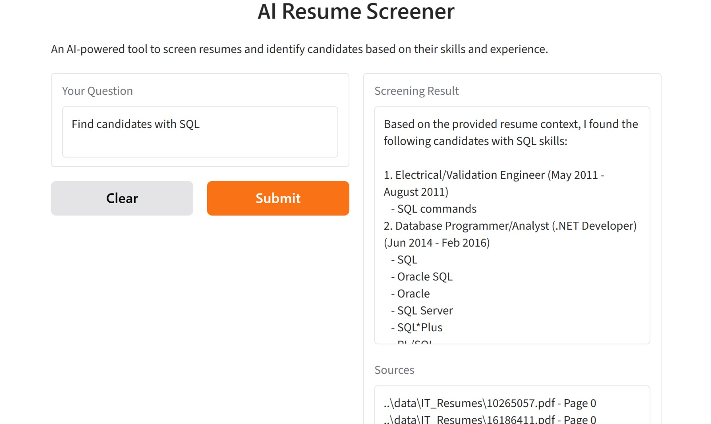
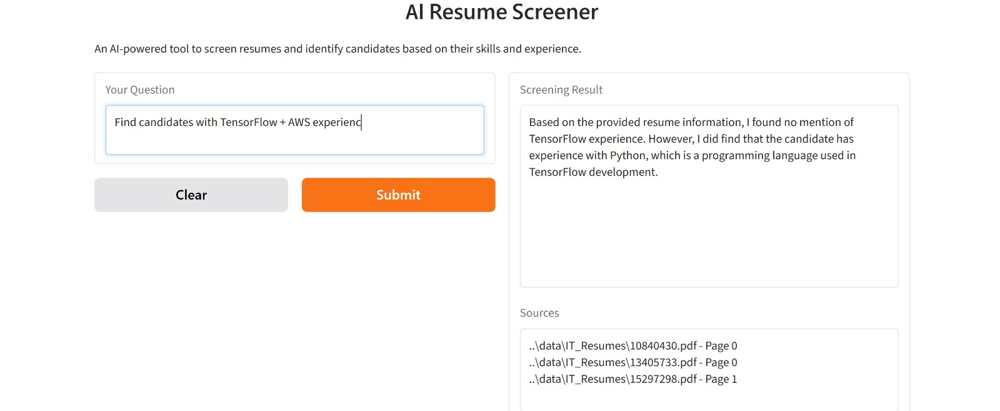

# AI Resume Screener using RAG

## Project Overview

The AI Resume Screener is a Retrieval-Augmented Generation (RAG) application that helps users search and analyze IT resumes using natural language questions.

The system retrieves relevant information from PDF resumes and uses the Llama 3.2 language model to generate answers based on the retrieved content.

## Project Objectives

- Load and process PDF resumes.
- Split resume text into smaller chunks.
- Convert text into vector embeddings.
- Store and search embeddings using FAISS.
- Retrieve relevant resume information.
- Generate answers using Llama 3.2 through Ollama.
- Provide an interactive interface using Gradio.

## Screenshots

### RAG Output - Example 1


### RAG Output - Example 2


## Dataset

This project uses the Resume Dataset from Kaggle:

**Dataset Name:** Resume Dataset

**Source:** Sneha Anbhawal

**Kaggle Link:**
https://www.kaggle.com/datasets/snehaanbhawal/resume-dataset

The dataset contains resume examples in PDF and CSV formats,
organized into different job categories.

For this project, we selected 20 resumes from the
INFORMATION-TECHNOLOGY category.

The dataset is used for educational and project demonstration purposes.
## Technologies Used

- Python
- LangChain
- Hugging Face Embeddings
- FAISS Vector Database
- Ollama
- Llama 3.2 (3B)
- Gradio
- PyPDF

## RAG Architecture

1. Load PDF resumes.
2. Split documents into chunks.
3. Generate embeddings using Hugging Face.
4. Store vectors in FAISS.
5. Retrieve relevant resume information.
6. Send retrieved context and the question to Llama 3.2.
7. Display the generated answer and sources through Gradio.

## Project Structure

```text
RAG-Resume-Screener/
│
├── data/
│   └── IT_Resumes/
│
├── src/
│   └── RAG_Resume_Screener.ipynb
│
└── README.md
```

## Installation

Install the required Python packages:

```bash
pip install langchain-community langchain-text-splitters langchain-classic sentence-transformers faiss-cpu pypdf langchain-huggingface langchain-ollama gradio
```

Install Ollama and download the model:

```bash
ollama pull llama3.2:3b
```

## How to Run

1. Open the project in Visual Studio Code.
2. Activate the Python virtual environment.
3. Open `src/RAG_Resume_Screener.ipynb`.
4. Select the correct Python kernel.
5. Run the notebook cells in order.
6. Launch the Gradio interface.
7. Enter questions about candidates' skills and experience.

## Example Questions

- Find candidates with Python experience.
- Find candidates with SQL experience.
- Find candidates with AWS experience.
- Find candidates with machine learning experience.

## Expected Output

The system provides:
- AI-generated answers based on retrieved resume information.
- Source PDF filenames.
- Page numbers of retrieved information.

## Language Model

This project uses Llama 3.2 (3B) through Ollama to generate answers locally without requiring a paid LLM API.

## Notes

- Resume information is retrieved from the provided PDF documents.
- The quality of answers depends on the retrieved context.
- The system should not be treated as a replacement for human recruitment decisions.
